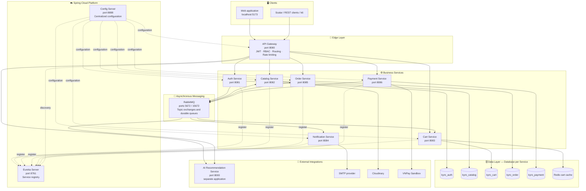
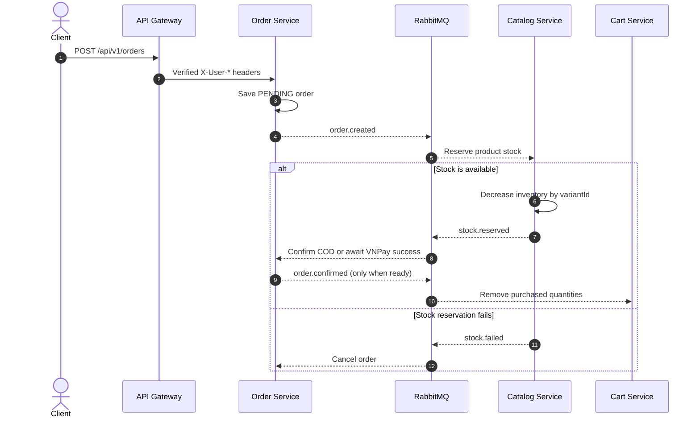

# Kyro E-Commerce Backend

[](https://openjdk.org/projects/jdk/21/)
[](https://spring.io/projects/spring-boot)
[](https://docs.docker.com/compose/)

Kyro is a microservices backend for an e-commerce platform. It provides centralized authentication and routing, product and inventory management, persistent carts, order processing, VNPay payments, asynchronous notifications, and an integration point for an external AI recommendation service.

## Features

- JWT authentication and role-based authorization at the API Gateway
- Email/password and Google/GitHub OAuth2 authentication
- Database-per-service persistence with PostgreSQL
- Redis cache-aside for persistent shopping carts
- RabbitMQ events for notifications and cross-service workflows
- VNPay payment URL signing and signed callback validation
- Cloudinary-backed product image management
- Service discovery and centralized configuration with Spring Cloud
- OpenAPI documentation and k6 load-testing scenarios

## Architecture



The repository contains ten Maven modules (nine applications plus the shared reliability library) and a Docker Compose environment with thirteen services. The AI service is a separate application configured through `AI_SERVICE_URI`; it is not built or started by this repository.

### Request and event flow

1. Clients send public and authenticated requests through the API Gateway.
2. The Gateway validates JWTs, enforces route-level roles, removes untrusted identity headers, and forwards verified `X-User-*` headers with an internal credential to downstream services.
3. Cart revalidates the selected `variantId`, active status, stock, and backend-calculated price; Order stores immutable item snapshots and publishes `order.created`.
4. Catalog reserves stock by `variantId` and publishes `stock.reserved` or `stock.failed`.
5. A reservation updates Order. `order.confirmed` removes purchased cart quantities: immediately for COD, after successful payment for VNPay. A failed reservation cancels the order.
6. Order, Payment and Catalog persist events in transactional outboxes. Confirmed, persistent RabbitMQ delivery is retried; consumers handle duplicates. Payment keeps every VNPay attempt and exposes callback/IPN endpoints.
7. Cancellation durably requests reservation release. Catalog publishes lifecycle snapshots and per-variant stock revisions. AI records purchases only on `order.delivered`. Email remains best effort.

See [docs/architecture.md](docs/architecture.md) for service communication boundaries, transactional outbox topology, multi-attempt payment reconciliation, and operational runbooks.

### Checkout saga



## Services

| Service | Port | Responsibility | Storage |
| --- | ---: | --- | --- |
| API Gateway | `8080` | Routing, JWT validation, role checks, rate limiting | Redis |
| Auth | `8081` | Accounts, JWT, OAuth2, OTP | PostgreSQL |
| Catalog | `8082` | Products, variants, attributes, inventory, reviews, images | PostgreSQL, Cloudinary |
| Cart | `8083` | Persistent carts and product validation | PostgreSQL, Redis |
| Notification | `8084` | Asynchronous email delivery | RabbitMQ |
| Order | `8085` | Checkout and order lifecycle | PostgreSQL |
| Payment | `8086` | VNPay payments and callbacks | PostgreSQL |
| Eureka Server | `8761` | Service discovery | In memory |
| Config Server | `8888` | Centralized service configuration | Local configuration files |
| AI service (external) | `8000` | Recommendation and semantic-search endpoints | Managed outside this repository |

PostgreSQL, Redis, RabbitMQ, and [Dozzle](https://dozzle.dev/) are also started by Docker Compose.

## Tech Stack

- Java 21, Spring Boot 3.3, Spring Cloud 2023.0
- Spring Security, OAuth2 Client, JJWT, OpenFeign
- PostgreSQL 16 with Flyway migrations, Redis 7, RabbitMQ 3
- Maven Wrapper, Spotless with Google Java Format
- Docker Compose, Go Task, k6

## Design Decisions

| Decision | Implementation |
| --- | --- |
| Centralized edge security | Spring Cloud Gateway validates JWTs and applies role checks before protected requests reach a service. |
| Trusted service identity | The Gateway strips client-supplied identity headers and injects values derived from verified token claims. |
| Database isolation | Auth, Catalog, Cart, Order, and Payment use separate PostgreSQL databases and Flyway migrations. |
| Persistent cache | PostgreSQL remains the cart source of truth; Redis accelerates reads through a cache-aside strategy. |
| Event-driven checkout | RabbitMQ decouples stock reservation, cart cleanup, payment updates, and notification delivery. |
| AI failure isolation | AI routes use rate limiting and a circuit breaker; the SSE route bypasses buffering for streaming responses. |
| Internal service calls | OpenFeign clients use a shared internal token when synchronous validation is required. |

## Getting Started

### Prerequisites

- Docker with Docker Compose v2
- Java 21 for running services outside Docker
- [Go Task](https://taskfile.dev/) for the documented command shortcuts

### Run the complete backend

```bash
cp .env.example .env
# Replace placeholder credentials and secrets in .env.
task run
```

`task run` builds the Java services, starts the complete Compose environment, and waits for service health checks. The external AI service must be started separately when testing `/api/v1/ai/**`; set `AI_SERVICE_URI` if it is not available at `http://localhost:8000`.

Useful local endpoints:

| Resource | URL |
| --- | --- |
| API Gateway | <http://localhost:8080> |
| Scalar API reference | <http://localhost:8080/scalar> |
| Eureka dashboard | <http://localhost:8761> |
| RabbitMQ management | <http://localhost:15672> |
| Dozzle logs | <http://localhost:9999> |

### Common commands

```bash
task status          # Show container health and status
task logs:cli        # Follow Docker Compose logs
task test            # Run the Maven test suite
task format:check    # Check Java formatting
task perf:feign      # Measure synchronous checkout dependencies
task perf:rabbitmq   # Measure payment event propagation
task perf:payment-failure # Exercise the failed-payment path
task stop            # Stop the Compose environment
```

Run `task --list` to see all service-specific and k6 commands.

> [!WARNING]
> `task clean` stops the environment and permanently removes its Docker volumes, including local database data.

## Configuration

Copy `.env.example` to `.env` and replace all placeholder secrets before starting the stack. Never commit `.env` or live credentials.

| Group | Required Variables | Purpose |
| --- | --- | --- |
| PostgreSQL | `DATABASE_USERNAME`, `DATABASE_PASSWORD`, `DATABASE_DB` | Container credentials; each service overrides its JDBC URL to an isolated database |
| Security | `JWT_SECRET`, `INTERNAL_API_TOKEN` | HMAC signing secret for Auth/Gateway and shared token protecting internal/identity-bearing routes |
| Mail & Branding | `MAIL_USERNAME`, `MAIL_PASSWORD`, `COMPANY_LOGO_URL` | SMTP credentials and branding for asynchronous OTP and order emails |
| Media | `CLOUDINARY_CLOUD_NAME`, `CLOUDINARY_API_KEY`, `CLOUDINARY_API_SECRET` | Product image uploads and deletions in Catalog |
| Payments | `VNPAY_TMN_CODE`, `VNPAY_HASH_SECRET`, `VNPAY_PAY_URL`, `VNPAY_RETURN_URL` | VNPay URL signing, browser return verification, and server-to-server IPN validation |

Optional integration variables include `AI_SERVICE_URI` (defaults to `http://host.docker.internal:8000` inside Compose) and OAuth2 client credentials (`GOOGLE_*`, `GITHUB_*`). In production, enable `USE_SECURE_COOKIE=true` behind TLS, restrict CORS origins, and expose only the API Gateway publicly.

## API Documentation

With the services running, open the aggregated Scalar UI at <http://localhost:8080/scalar>. Individual OpenAPI specifications are proxied through the Gateway:

```text
http://localhost:8080/auth-service/v3/api-docs
http://localhost:8080/catalog-service/v3/api-docs
http://localhost:8080/cart-service/v3/api-docs
http://localhost:8080/order-service/v3/api-docs
http://localhost:8080/payment-service/v3/api-docs
http://localhost:8080/notification-service/v3/api-docs
```

Send client traffic through port `8080` with `Authorization: Bearer <accessToken>` on protected routes. Downstream services reject unauthenticated `X-User-*` headers and internal `/api/v1/internal/**` calls that do not carry a valid `X-Internal-Token`.

## Development and Testing

```bash
./mvnw test              # Run unit tests across modules
./mvnw verify            # Run full test suite including Testcontainers integration tests
./mvnw spotless:check    # Verify Google Java Format compliance
./mvnw clean package     # Package all Maven modules
```

Integration tests in `reliability`, `catalog-service`, and `payment-service` spin up isolated PostgreSQL and RabbitMQ containers via Testcontainers and never touch local development databases.

The [`k6/performance`](k6/performance/) directory provides load-testing scenarios covering synchronous OpenFeign checkout validation, asynchronous RabbitMQ payment propagation, and failed-payment handling against disposable fixtures.

## Architecture Deep Dive

See [docs/architecture.md](docs/architecture.md) for detailed documentation on:

- Synchronous OpenFeign vs. asynchronous RabbitMQ service boundaries
- Transactional outbox delivery, dead-letter routing (`kyro.dlx`), and SQL replay runbook
- Stock reservation state machine (`RESERVED` / `REJECTED` / `RELEASED`) and idempotent checkout
- Multi-attempt VNPay reconciliation, signed IPN handling, and AI event projections

## Repository Layout

```text
.
├── reliability/          # Shared transactional outbox and RabbitMQ topology library
├── api-gateway/          # Edge gateway, JWT/RBAC filters, and AI route bridging
├── auth-service/         # Identity, JWT issuance, OAuth2, and OTP management
├── catalog-service/      # Products, variants, stock reservations, reviews, and media
├── cart-service/         # Persistent shopping cart and Redis cache
├── order-service/        # Idempotent checkout and order lifecycle saga
├── payment-service/      # Multi-attempt VNPay integration, IPN, and reconciliation
├── notification-service/ # RabbitMQ email consumer
├── config-server/        # Centralized Spring Cloud configuration
├── eureka-server/        # Service discovery registry
├── docker/               # PostgreSQL database initialization scripts
├── docs/                 # System architecture and operational documentation
└── k6/                   # Load and resilience test scenarios
```
